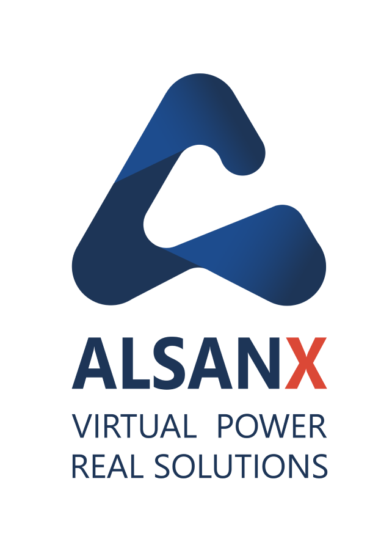

  

# AlsanX

**Industrial Intelligence · Digital Twins · Simulation · AI**

AlsanX builds intelligent digital solutions for complex industrial operations. We combine **digital twins, simulation, AI, data analytics, and immersive 3D/XR** to help organizations understand their operations, identify bottlenecks, and make better decisions before changes become costly.

### What we do

- 🏭 **Digital Twins** — Model real production and logistics systems
- 📊 **Simulation & Optimization** — Test capacity, flow, layouts, and operational scenarios
- 🤖 **Industrial AI** — Turn operational data into actionable insights
- 👁️ **Computer Vision** — Enable AI-driven quality inspection
- 🥽 **3D & XR** — Build immersive visualization and operator-training environments
- 🚢 **Industrial & Logistics Solutions** — Support manufacturing, ports, supply chains, and complex operations

### Our approach

We connect **engineering, simulation, AI, and visualization** around a single operational model — turning real-world complexity into decision-ready intelligence.

### Technology

`AnyLogic` · `anyLogistix` · `Python` · `AI/ML` · `Computer Vision` · `NVIDIA Omniverse` · `XR`

### Learn more

🌐 [alsanx.com](https://alsanx.com)  
💼 [LinkedIn](https://www.linkedin.com/company/alsanx/)

> **Model the operation. Simulate the future. Make better decisions.**